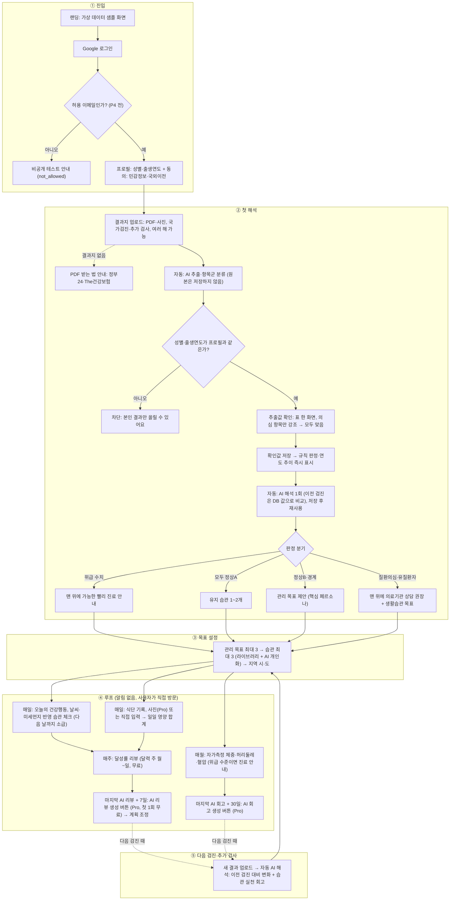

# User Flow

사용자 여정 단계는 ①~⑤, 개발 단계는 P0~P4로 표기한다.

## 흐름

- AI 리뷰·회고는 자동으로 생성하지 않는다. 직전 리뷰 이후의 기록을 분석하고, '○월 ○일 기록 기준'으로 저장한다. 소급 입력을 해도 저장된 리뷰는 바뀌지 않는다
- 무료 주간 달성률은 최신 기록으로 계속 계산한다

## 가설과 측정
| # | 단계 | 가설 | 측정 |
|---|---|---|---|
| H1 | 진입 | 사용자는 결과지(PDF·사진)를 구해서 올릴 수 있다 | 가입 → 업로드 완료율 |
| H2 | 첫 해석 | 쉬운 해석과 추이가 '관리하겠다'는 결심으로 이어진다 | 해석 → 목표 설정 완료율 |
| H3 | 루프 | 알림 없이도 작은 일일 행동, 날씨 맞춤, 주간 리뷰가 재방문과 습관을 만든다 | 주간 달성률 70%, 4주 리텐션 |
| H4 | 효과 | 습관이 이어지면 자가측정 수치와 다음 검사 수치가 개선 방향으로 움직인다 | 월간 측정 추세, 다음 검사 변화 |
| H5 | 수익 | AI 주간 코칭과 식단 사진 분석에 돈을 낸다 | 첫 무료 AI 리뷰 후 Pro 전환율 |

## 유스케이스
| UC | 사용자 목표 | 단계 | 과금 |
|---|---|---|---|
| UC1 | 랜딩 샘플 화면 보기 · 가입 · 프로필 · 동의 | ① | 무료 |
| UC2 | 결과지 업로드(PDF·사진)·추출값 확인 | ② | 무료 |
| UC3 | AI 해석 자동 1회 생성·저장된 해석 보기·연도 추이·추가 검사 해석 보기 | ② | 무료 |
| UC4 | 관리 목표·습관·지역 설정 | ③ | 무료 |
| UC5 | 오늘의 건강행동 체크(날씨 반영, 소급) | ④ 매일 | 무료 |
| UC6 | 식단 직접 입력 | ④ 매일 | 무료 |
| UC7 | 식단 사진 분석 | ④ 매일 | Pro |
| UC8 | 주간 달성률 리뷰(달력 주) | ④ 매주 | 무료 |
| UC9 | AI 주간 리뷰 생성(마지막 리뷰 + 7일)·저장된 리뷰 보기·계획 조정 | ④ 7일 주기 | Pro (첫 1회 무료) |
| UC10 | 월간 자가측정·회고·AI 회고 생성(마지막 회고 + 30일) | ④ 매월 / 30일 주기 | 무료 (AI 리포트는 Pro) |
| UC11 | 다음 검진·추가 검사 업로드·회고·목표 재설정 | ⑤ | 무료 |
| UC12 | Pro 구독·해지 | 전환 | - |
| UC13 | 탈퇴(데이터 삭제) | 언제나 | 무료 |

## 시나리오
페르소나 A: 38세 회사원, 매년 회사 검진을 받는다. 공복혈당 108(정상B), ALT 경계.

- **S1 첫 사용**: 랜딩 샘플 화면 → 가입·프로필·동의 → 지난 검진 PDF와 추가 간수치 검사 사진 업로드 → 표에서 '모두 맞음' → 규칙 판정·추이 확인과 AI 해석 자동 생성 → 공복혈당이 몇 년간 계속 오른 것을 처음 봄(Aha) → 목표 2개, 습관 3개, 지역 설정
- **S2 평일 저녁**: 오늘의 건강행동 페이지 방문 → 미세먼지가 '나쁨'이라 '저녁 후 걷기 30분' 대신 실내 습관이 나옴 → 체크 → 저녁 식단 직접 입력 → 나트륨 합계가 목표를 넘었다고 표시
- **S3 습관 등록 7일 뒤**: AI 리뷰 생성 버튼 활성화 → 첫 AI 리뷰(무료)가 지난 7일 달성률 64%를 보고 "평일 저녁 걷기가 자주 빠짐 → 점심 산책으로"를 제안 → 계획 조정 → 다음 리뷰부터 Pro 안내
  - 생성한 뒤에는 저장된 리뷰를 보여준다. 다음 날 소급 입력으로 달성률이 바뀌어도 AI 리뷰는 생성 당시 기록 기준으로 유지한다
  - 다음 리뷰 버튼은 7일 뒤 활성화되고, 이번 리뷰 범위의 다음 날부터 기록을 분석한다
- **S4 습관 등록 30일 뒤**: 체중·허리둘레·혈압 입력 → 지난 측정 대비 변화 → 회고. Pro 사용자는 활성화된 AI 회고 버튼으로 회고를 생성하고, 이후에는 저장된 회고를 본다. 다음 회고 버튼은 30일 뒤 활성화된다
- **S5 1년 뒤 검진**: 공복혈당 108 → 101, ALT 정상 → 업로드·확인 후 AI 해석이 이전 검진 대비 변화와 습관 실천 기록을 함께 회고 → 새 목표
